# Indoor Autonomous Delivery Robot

An indoor delivery robot that maps a building with **ArUco-marker visual SLAM**, plans the
shortest multi-stop tour with **Dijkstra + Held-Karp**, and drives it on its own. Customers
order from a **web shop** (React + Spring Boot + MySQL), an operator loads the robot, and the
robot delivers. Everything runs first in a **ROS 2 Jazzy / Gazebo Harmonic** simulation of a
two-building campus and is then moved to the real robot (Raspberry Pi 4), which serves the
same REST API as the simulation.

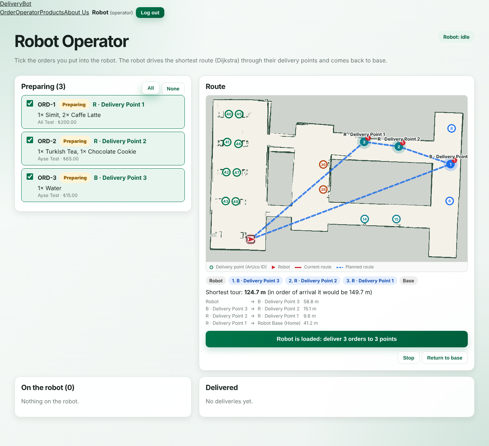

## Contents

- [Features](#features)
- [System architecture](#system-architecture)
- [Repository layout](#repository-layout)
- [Requirements](#requirements)
- [Setup](#setup)
- [Running](#running)
- [How it works](#how-it-works)
- [Screenshots](#screenshots)
- [Simulation vs. real robot](#simulation-vs-real-robot)
- [Further documentation](#further-documentation)

## Features

- **Gazebo campus world** (`two_buildings`, `campus_area`) with ArUco markers (DICT_4X4_50) on the
  walls, tables and delivery floor pads, plus a Robotnik **RB1** base with 2D lidar, IMU, RGB-D camera and a
  mast camera for marker detection.
- **ArUco detection** with OpenCV (`solvePnP`, IPPE_SQUARE) giving range, bearing and marker
  orientation in the robot frame.
- **ArUco EKF-SLAM mapper** that explores on its own (frontiers + wall viewpoints), builds an
  occupancy grid plus a landmark map, and saves delivery points in front of each marker.
- **Offline map correction**: pose-graph optimisation (robust Gauss-Newton, numpy only) with
  odometry, marker and lidar loop edges, to repair maps spoiled by wheel slip.
- **Delivery navigator**: localisation on the known markers + lidar matching, Dijkstra on a
  clearance map, exact best visiting order (Held-Karp up to 12 stops, then 2-opt), pure-pursuit
  driving, obstacle stop/replan, and a check that the right marker is in view at each stop.
- **web_bridge**: the navigator behind a small HTTP API (`/robot/status`, `/robot/plan`,
  `/robot/mission`, `/robot/map.png`, `/robot/camera-stream`, ...), identical to the real
  robot's API on the Raspberry Pi.
- **DeliveryBot web app**: user shop with a clickable campus map, operator page with the
  shortest tour, admin pages for orders, users, robot settings, live camera and manual control
  (take control / release / emergency stop).
- **slam_toolbox variant**: a lidar-only copy of the simulation for mapping with
  `slam_toolbox` and RViz.
- PyQt tools: teleop, delivery GUI, and a robot-vision overlay viewer.

## System architecture

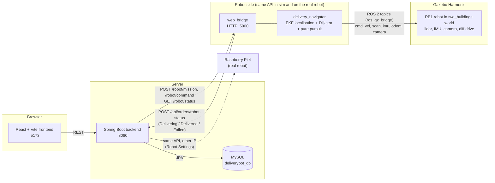

The backend never talks to ROS directly. It talks to "the robot" over HTTP on port 5000. In
simulation that is `web_bridge`, on the real robot it is the Raspberry Pi. Switching between
them is only a change of IP and port in **Admin → Robot Settings**.

ROS 2 data flow inside the simulation:

```
Gazebo ──ros_gz_bridge──> /robot/front_laser/scan, /robot/imu/data,
                          /robot/aruco_camera/image_raw, /clock
diff_drive_controller ──> wheel odometry
aruco_slam_mapper ──> maps/<name>/{map.pgm, map.yaml, aruco_landmarks.yaml}
delivery_navigator / web_bridge <── map + landmarks
          ──> /cmd_vel ──twist_to_stamped_bridge──> /robot/diff_drive_controller/cmd_vel
```

## Repository layout

```
.
├── ros2_ws/                         Main ROS 2 workspace (ArUco SLAM + delivery + web bridge)
│   ├── src/indoor_delivery_project/      ament_python package: nodes, launch, worlds, models, config
│   │   ├── indoor_delivery_project/      aruco_detector, aruco_slam_mapper, delivery_navigator,
│   │   │                                 web_bridge, correct_map, map_optimizer, delivery_gui,
│   │   │                                 robot_vision, pyqt_teleop, video_recorder, ...
│   │   ├── launch/                       sim.launch.py, web_sim.launch.py, record.launch.py
│   │   ├── worlds/                       two_buildings.sdf, campus_area.sdf
│   │   ├── models/                       ArUco marker models (generated by scripts/)
│   │   ├── config/                       marker positions, ros_gz bridge, diff-drive controller
│   │   ├── docs/                         detailed guides (see below)
│   │   ├── examples/  scripts/  dev/
│   ├── src/indoor_delivery_robot_description/   RB1 URDF/xacro with the mast ArUco camera
│   ├── dependencies.repos            Pinned Robotnik RB1 packages (cloned by setup_workspace.sh)
│   ├── patches/                      One-line fix for robotnik_description (controller YAML path)
│   ├── setup_workspace.sh            Clone deps, patch, rosdep, colcon build
│   └── run_web_sim.sh                Start Gazebo + web_bridge + backend + frontend in one command
├── slam_toolbox_ws/                 Lidar-only variant: Gazebo + slam_toolbox + RViz
├── maps/                            Saved SLAM maps (campus_full_map7 for two_buildings, campus6 for campus_area)
├── web_app/
│   ├── backend/                      Spring Boot 3.5 (Java 17, Maven wrapper)
│   ├── frontend/                     React 19 + Vite 6
│   ├── database/                     create_database.sql, seed_users.sql, reset_database.sh
│   └── WEB_APP_GAZEBO.md             Web app ↔ simulation guide
├── hardware/                        Real-robot side prototypes (OpenCV seven-segment reader)
└── docs/images/                     Screenshots used in this README
```

The two ROS workspaces both contain a package called `indoor_delivery_project`. Build and
source them separately, and never source both in the same terminal.

## Requirements

| Part | Version used |
|---|---|
| Ubuntu | 24.04 LTS |
| ROS 2 | Jazzy (`ros-jazzy-desktop`) |
| Gazebo | Harmonic (`ros-jazzy-ros-gz`) |
| ros2_control | `ros-jazzy-gz-ros2-control`, `ros-jazzy-ros2-controllers` |
| Python | 3.12 with OpenCV (aruco module), numpy, PyYAML, PyQt5 |
| Java | 17 (Spring Boot 3.5, Maven wrapper included) |
| Node.js | 18+ with npm |
| MySQL | 8.x |
| Tools | `python3-vcstool`, `python3-rosdep`, `python3-colcon-common-extensions` |

```bash
sudo apt install ros-jazzy-desktop ros-jazzy-ros-gz ros-jazzy-gz-ros2-control \
    ros-jazzy-ros2-controllers ros-jazzy-xacro ros-jazzy-cv-bridge \
    python3-vcstool python3-rosdep python3-colcon-common-extensions \
    python3-opencv python3-numpy python3-yaml python3-pyqt5 \
    openjdk-17-jdk nodejs npm mysql-server
```

For the slam_toolbox variant also: `sudo apt install ros-jazzy-slam-toolbox ros-jazzy-nav2-map-server`.

## Setup

### 1. Clone

```bash
git clone https://github.com/<user>/<repo>.git ~/indoor-delivery-robot
cd ~/indoor-delivery-robot
```

### 2. ROS 2 workspace

```bash
cd ros2_ws
./setup_workspace.sh          # clones the RB1 packages, applies the patch, rosdep, colcon build
source install/setup.bash
```

`setup_workspace.sh` imports the Robotnik packages listed in `dependencies.repos` at the exact
commits this project was tested with, and patches `rb1_control.urdf.xacro` so the robot's
`gz_ros2_control` plugin loads `indoor_delivery_project/config/rb1_diff_drive_controllers.yaml`.

### 3. Database

```bash
sudo systemctl start mysql
sudo mysql < web_app/database/create_database.sql
```

Start the backend once (step 4) so Hibernate creates the tables, then load the test users:

```bash
mysql -u deliverybot_user -p deliverybot_db < web_app/database/seed_users.sql
```

The database password in `create_database.sql` and `application.properties` is a **local
development default**. Choose your own and pass it to the backend with environment variables:

```bash
export DB_URL=jdbc:mysql://localhost:3306/deliverybot_db
export DB_USERNAME=deliverybot_user
export DB_PASSWORD=<your password>
export ROBOT_BASE_URL=http://localhost:5000     # web_bridge in simulation
```

Test accounts from `seed_users.sql` (development only):

| Role | E-mail | Password | Lands on |
|---|---|---|---|
| ADMIN | admin@deliverybot.com | admin123 | `/admin` |
| OPERATOR | operator@deliverybot.com | operator123 | `/operator` |
| USER | user1@deliverybot.com | user123 | `/main` (shop) |

### 4. Web app

```bash
cd web_app/backend && ./mvnw spring-boot:run              # http://localhost:8080
cd web_app/frontend && npm install && npm run dev          # http://localhost:5173
```

## Running

### Everything in one command (simulation + web app)

```bash
cd ~/indoor-delivery-robot/ros2_ws
./run_web_sim.sh --build      # first time
./run_web_sim.sh              # afterwards
```

This starts Gazebo with the `two_buildings` world, `web_bridge` with `maps/campus_full_map7`,
the Spring Boot backend and the Vite frontend. Open <http://localhost:5173>, then in
**Admin → Robot Settings** choose **Use Gazebo Simulation**. Ctrl+C stops everything.

Useful options (`name:=value`):

```bash
./run_web_sim.sh gui:=false rtf:=3.0       # no Gazebo window, 3x real time
./run_web_sim.sh webapp:=false             # only Gazebo + web_bridge
./run_web_sim.sh world:=campus_area map_dir:=$HOME/indoor-delivery-robot/maps/campus6
```

The world must match the map: `campus_full_map7` was made in `two_buildings` (start at
-17, -17), `campus6` in `campus_area` (start at -25, 0).

### Simulation only

```bash
cd ros2_ws && source install/setup.bash
ros2 launch indoor_delivery_project sim.launch.py world:=two_buildings
ros2 run indoor_delivery_project pyqt_teleop          # drive by hand
```

### Build a new ArUco SLAM map

```bash
ros2 launch indoor_delivery_project sim.launch.py world:=two_buildings rtf:=5.0
ros2 run indoor_delivery_project aruco_slam_mapper --ros-args \
    -p initial_pose:="[-17.0, -17.0, 0.0]" \
    -p output_dir:=$HOME/indoor-delivery-robot/maps/my_map
```

The robot explores on its own and saves the map when done (or on Ctrl+C, and every 60 s).

### Deliver along a route

```bash
ros2 run indoor_delivery_project delivery_navigator --ros-args \
    -p map_dir:=$HOME/indoor-delivery-robot/maps/campus_full_map7 \
    -p route_start:=home \
    -p stops:="['a_delivery_point_2', 'b_delivery_point_3', 'r_delivery_point_1']"

ros2 run indoor_delivery_project delivery_gui --ros-args \
    -p map_dir:=$HOME/indoor-delivery-robot/maps/campus_full_map7     # click-to-deliver GUI
```

### Lidar SLAM with slam_toolbox

```bash
cd ~/indoor-delivery-robot/slam_toolbox_ws
./setup_workspace.sh && source install/setup.bash
ros2 launch indoor_delivery_project slam.launch.py     # Gazebo + slam_toolbox + RViz
ros2 run indoor_delivery_project pyqt_teleop           # drive around, then save the map:
ros2 run nav2_map_server map_saver_cli -f ~/maps/campus_area --ros-args -p use_sim_time:=true
```

See [slam_toolbox_ws/README.md](slam_toolbox_ws/README.md) for how this variant differs.

## How it works

**Detection.** `aruco_detector` / `aruco_utils` detect markers in the mast camera image
(`/robot/aruco_camera/image_raw`) and use `solvePnP` with the marker size from
`config/aruco_markers.yaml` to get range, bearing and the direction the marker faces.

**SLAM.** `aruco_slam_mapper` runs an EKF over the robot pose and the x, y of every marker.
Wheel odometry gives distance and the IMU gyro gives heading (wheels slip in turns). Marker IDs
solve data association, so there are no wrong matches. It explores by picking the nearest
frontier or wall viewpoint, so every wall is seen from close range, and draws the occupancy
grid from the lidar. Output: `map.pgm`/`map.yaml` (Nav2 format), `aruco_landmarks.yaml` with
every marker and the delivery points 2.3 m in front of them, and `map_preview.png`.

**Correction.** `correct_map` and `optimize_map` rebuild a run as a pose graph (keyframes every
0.3 m / 10°, odometry, marker and lidar loop edges) and solve it with robust Gauss-Newton,
optionally using an earlier good map as the base.

**Planning and driving.** `delivery_navigator` turns the map into a 0.2 m clearance grid,
runs Dijkstra from every stop to get all leg lengths, finds the best visiting order (Held-Karp,
exact up to 12 stops), and drives each leg with pure pursuit. It replans every 15 s and after
each pose correction, stops for obstacles and plans around them if they stay, and at each stop
turns to the marker and checks the camera sees the right ID before reporting *Delivered*.

**Web link.** `web_bridge` wraps the navigator in an HTTP server. The operator page calls
`/robot/plan` to show the shortest tour against the order-of-arrival tour, then `/robot/mission`
to start it. The bridge reports each order's status back to the backend, and the user's and
operator's pages update on their own.

## Screenshots

### Simulation and SLAM

| | |
|---|---|
| 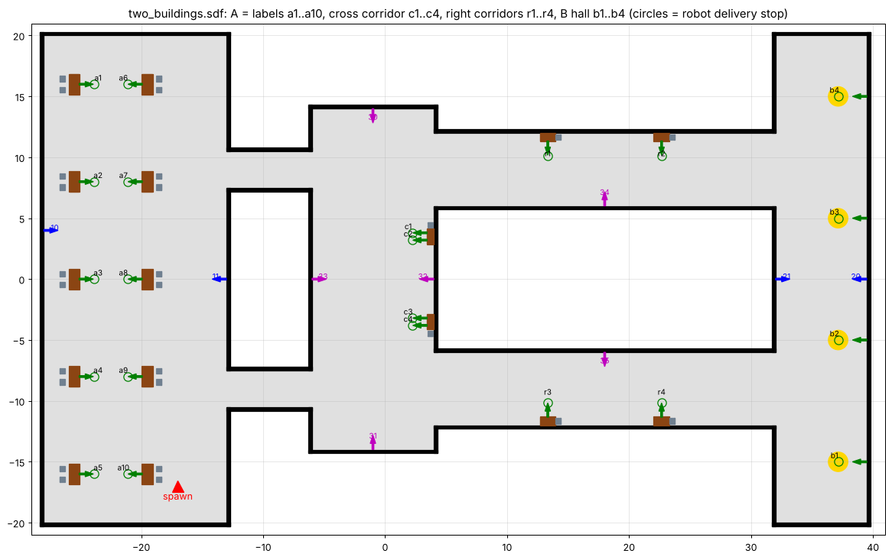 | 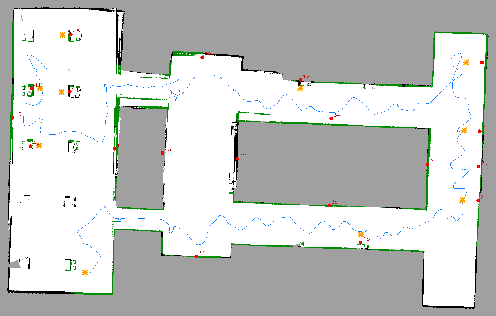 |
| `two_buildings` Gazebo world from above | ArUco SLAM map used by the web app (markers red, delivery points as stars) |
| 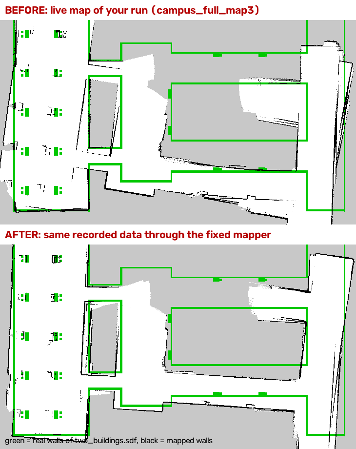 | 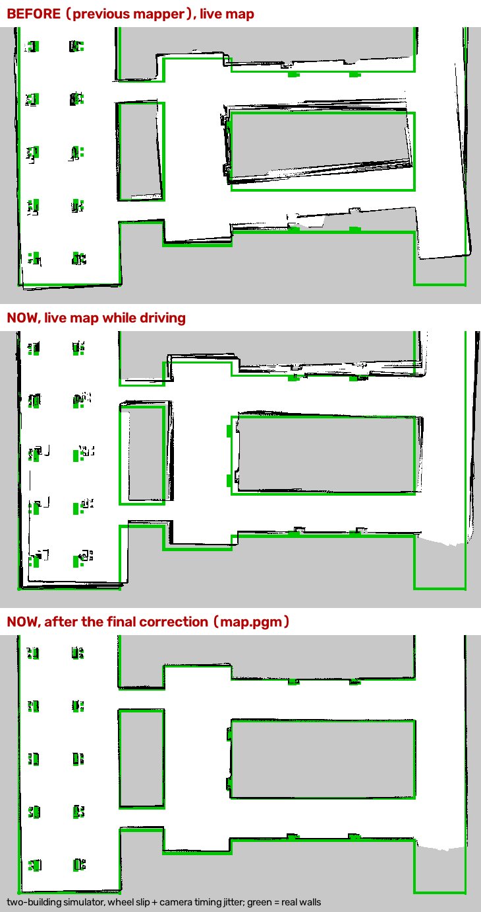 |
| Live map vs. the same data through the fixed mapper (green = real walls) | Heading fix for in-place turns |
| 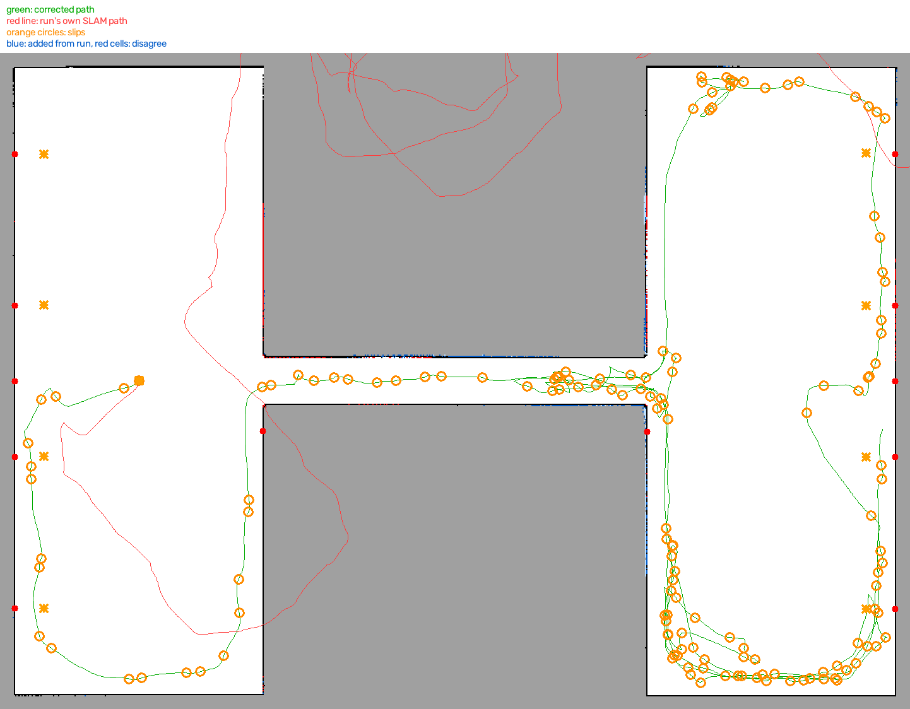 | 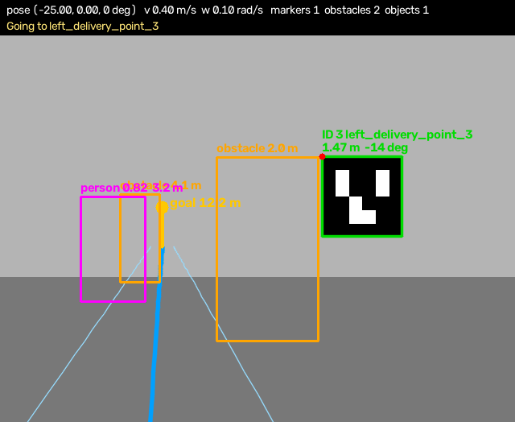 |
| Pose-graph correction of a run with 15 % wheel slip | Mast camera with detected markers |

### Delivery planning

| | |
|---|---|
| 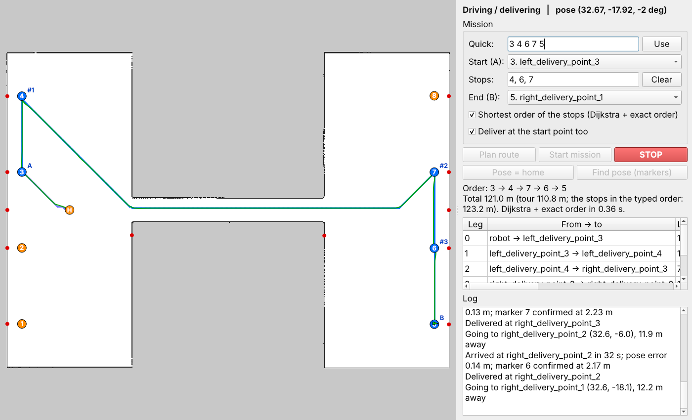 | 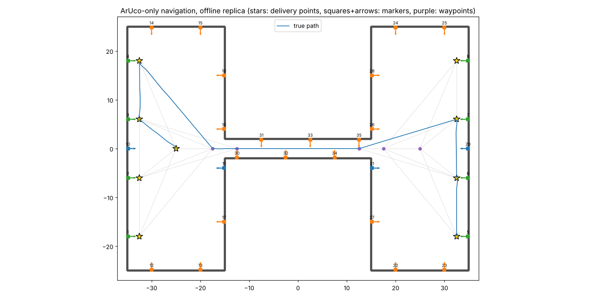 |
| Delivery GUI: multi-stop mission 3 → 4 → 6 → 7 → 5 | Offline test of the same mission on the SLAM map |

### Web application

| | |
|---|---|
| 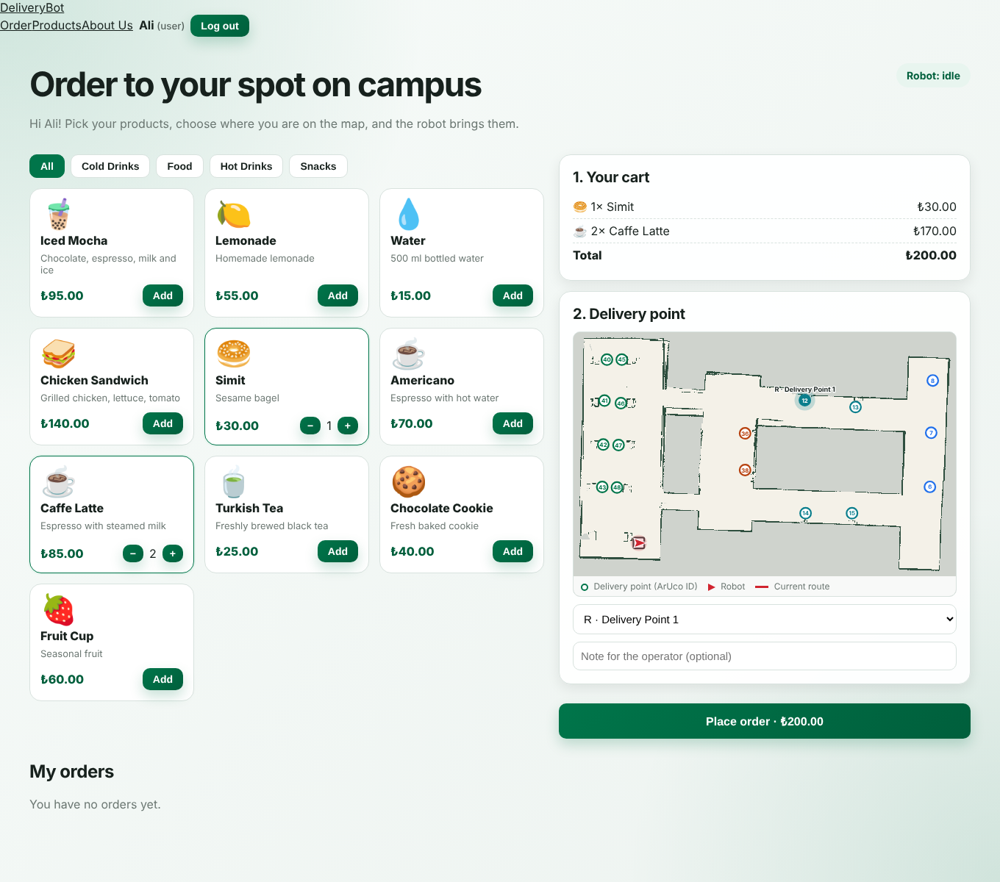 |  |
| User shop: cart and delivery point on the campus map | Operator: shortest tour and loading the robot |
| 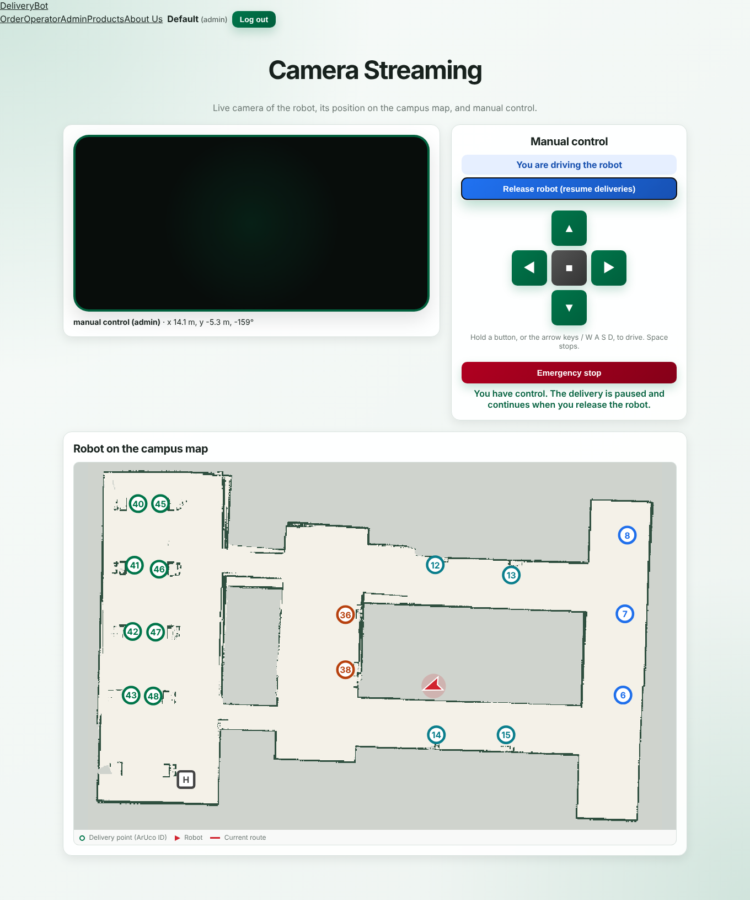 | 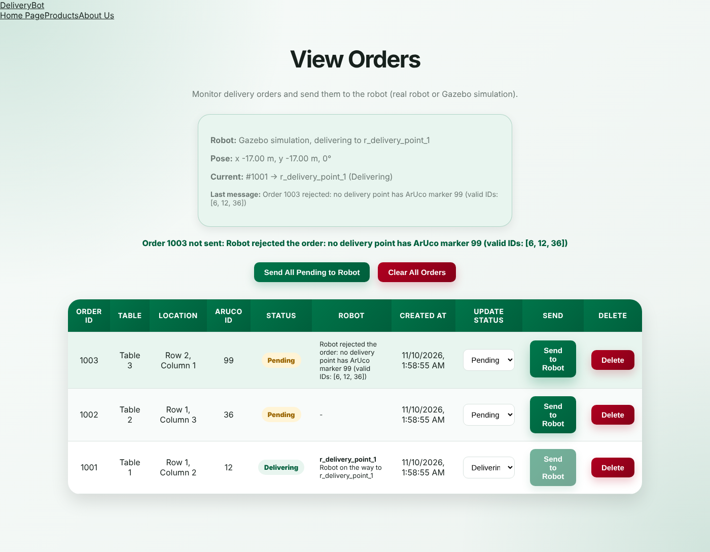 |
| Admin: live camera from Gazebo and manual control | Admin: all orders with live status |
| 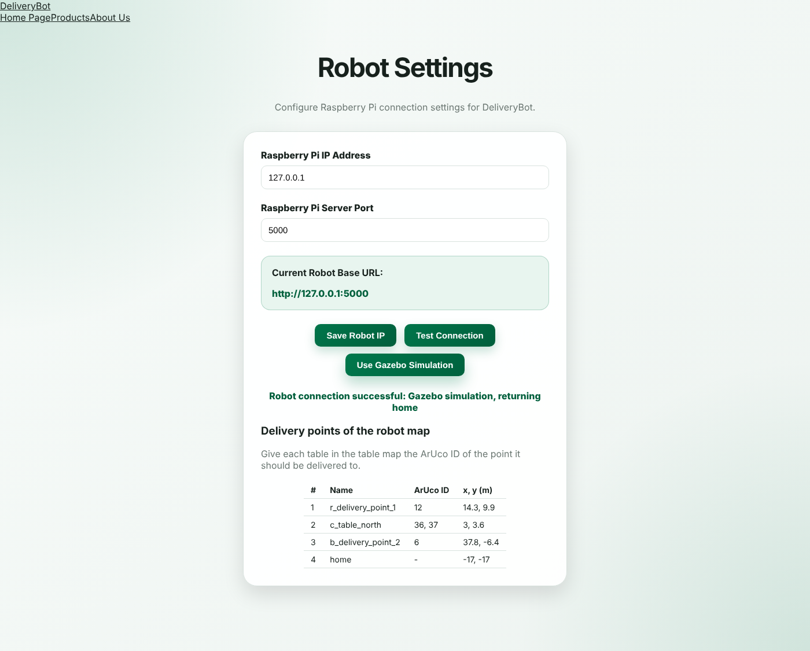 | 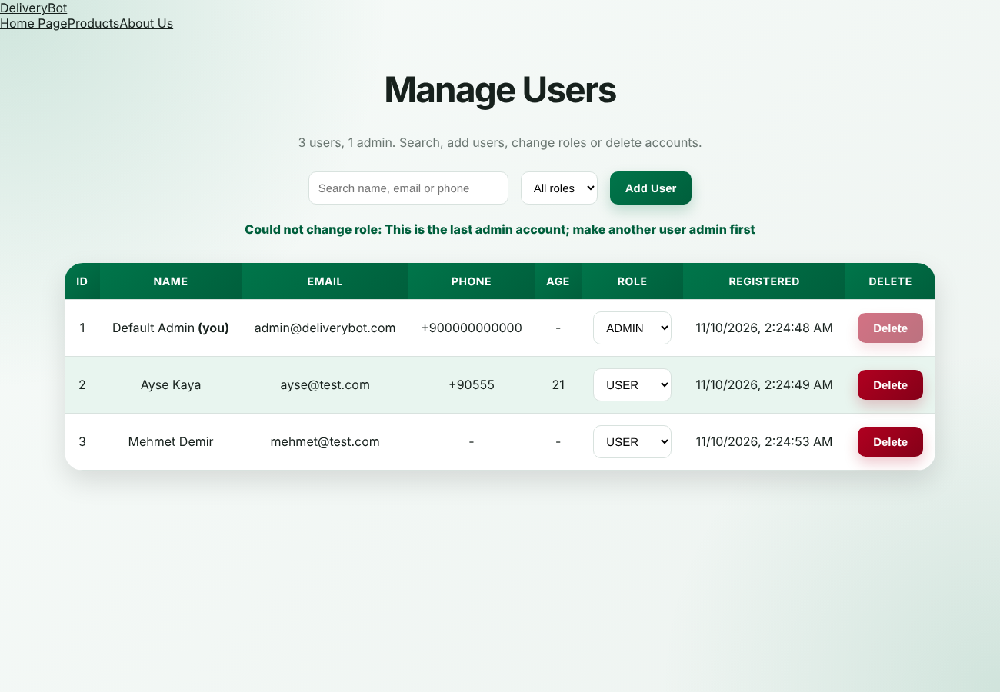 |
| Robot settings: real robot IP or Gazebo simulation | Manage users and roles |

## Simulation vs. real robot

| | Simulation | Real robot |
|---|---|---|
| Robot API on :5000 | `web_bridge` (ROS 2 node) | Raspberry Pi 4 service |
| Sensors | Gazebo lidar, IMU, cameras | physical sensors |
| Selected in | Admin → Robot Settings → *Use Gazebo Simulation* | Admin → Robot Settings → robot IP |

Because both sides serve the same REST API, the web app does not change when moving from
simulation to hardware.

## Further documentation

- [Commands cheat sheet](ros2_ws/src/indoor_delivery_project/docs/COMMANDS.md)
- [ArUco SLAM mapping and delivery](ros2_ws/src/indoor_delivery_project/docs/aruco_slam_and_delivery.md)
- [ArUco markers and camera](ros2_ws/src/indoor_delivery_project/docs/aruco_and_camera.md)
- [ArUco tutorial](ros2_ws/src/indoor_delivery_project/docs/TUTORIAL_aruco.md)
- [Robot commands and OpenCV dev setup](ros2_ws/src/indoor_delivery_project/docs/robot_commands_and_opencv_dev.md)
- [Web app ↔ Gazebo](web_app/WEB_APP_GAZEBO.md)
- [slam_toolbox variant](slam_toolbox_ws/README.md)

The guides were written in the original development workspace, so their commands use
`~/ros2_jazzy_ws` and `~/ros2_jazzy_ws/maps/...`. In this repository those are `ros2_ws/` and
`maps/`.

## Third-party code

The Robotnik RB1 robot, sensors and worlds come from
[RobotnikAutomation](https://github.com/RobotnikAutomation) (`dependencies.repos`) and keep
their own licenses. They are cloned at setup time, not stored in this repository.

## License

The ROS packages declare Apache-2.0 in `package.xml`.
